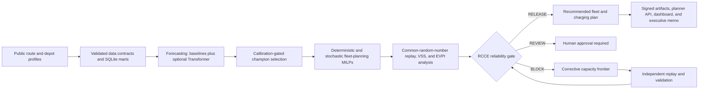
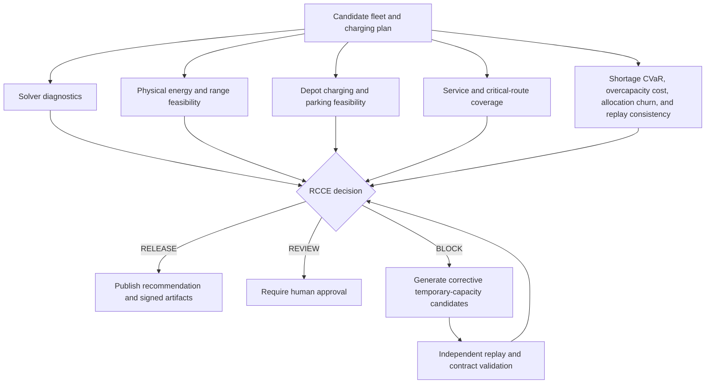

# Decision-Aware EV Fleet Planning, Depot Charging & Reliability Digital Twin
[](https://github.com/ReviveCoding/decision-aware-ev-fleet-planning/actions/workflows/ci.yml)


A fully runnable, offline decision system for EV fleet allocation, depot charging, rolling redeployment, stochastic optimization, and reliability-aware release decisions.

The repository is designed as portfolio evidence for Fleet Planning, Operations Research, Decision Science, Applied Scientist, and Data Scientist roles. It begins with statistical and business baselines, promotes advanced methods only when they improve decision evidence, and prevents nominal MILP feasibility from being mistaken for operational reliability.

## System architecture



## End-to-end pipeline

```text
public-style route/depot profiles
→ validated data contracts and SQLite SQL marts
→ statistical and ML forecasting
→ calibration-gated, decision-aware forecast selection
→ deterministic expected-value MILP
→ risk-neutral stochastic MILP
→ risk-aware CVaR MILP
→ exact VSS/EVPI recourse analysis
→ common-random-number operational replay
→ RCCE release/review/block gate
→ corrective capacity frontier
→ rolling reoptimization
→ planner API, audit artifacts, and executive memo
```

## What is implemented

### Fundamentals

- deterministic synthetic data generation with explicit provenance
- schema, range, uniqueness, and foreign-key-like contracts
- SQLite staging, intermediate, feature, capacity, and reconciliation marts
- seasonal-naive, Poisson, and quantile boosting forecasts
- temporal holdout, MAE, pinball loss, interval coverage, worst-station error
- carry-forward fallback, exact toy-friendly MILP structure, fleet conservation, parking, cube, range, charging, and emergency-recourse constraints

### Operational system

- station and vehicle-type fleet allocation
- capacity-limited emergency leasing
- site-power, charger-port, dwell-time, outage, and charging-taper effects
- common-random-number paired policy replay
- station-level shortage diagnostics
- corrective temporary-capacity candidates
- event-driven rolling reoptimization under compound stress
- FastAPI planner endpoints and non-persistent override replay
- transactional staged runs, artifact/generated-data manifests, checksums, strict JSON, audit reports, Docker, and CI

### Advanced science

- decision-aware forecast champion selection
- two-stage risk-neutral stochastic MILP
- CVaR risk-aware stochastic MILP
- formal sample VSS and EVPI using exact fixed-allocation recourse MILPs
- separately labeled held-out empirical VSS and EVPI estimates
- SAA replications with common out-of-sample evaluation
- optional CUDA-capable temporal quantile Transformer challenger

### Research-derived specialty

The **Reliability-Calibrated Capacity Envelope, RCCE** evaluates a plan as a vector rather than an opaque score:

- service-coverage lower confidence bound
- critical-route coverage lower confidence bound
- physical energy/range feasibility
- depot-charging feasibility
- shortage CVaR95
- overcapacity cost
- allocation churn
- solver degradation status

A solver-feasible plan may still be `REVIEW` or `BLOCK`. Corrective candidates are independently replayed and gated again before any automatic release.

## Reliability-gated decision flow



## Current v0.7.1rc4 smoke result

The bundled smoke configuration is a correctness and integration test, not a business-impact claim. The v0.7.1rc4 candidate preserves the v0.7.0 scientific result while hardening source-checkout and handoff behavior:

- the decision-aware forecast gate selected `seasonal_naive` after split-conformal calibration and downstream fleet-decision replay;
- the selected base policy was the risk-neutral stochastic plan, while automatic release still required an independently replayed corrective candidate;
- formal sample VSS was `741.66`, formal sample EVPI was `340.72`, and held-out empirical VSS was `738.10`;
- the recommended corrective candidate reached RCCE `RELEASE` only after physical, parking, charging, fleet-balance, numerical-solver, and replay gates passed;
- the recommended MILP termination was `OPTIMAL`, MIP gap was zero, maximum linear-constraint violation was approximately `3.64e-12`, integrality violation was zero, and objective reconciliation error was zero;
- all released data, plans, reports, and manifests share one immutable `run_id` and are rejected by the API if the run changes during a request;
- all paired policy comparisons use identical exogenous scenarios and common random draws.

The medium profile deliberately reports a different conclusion: formal VSS is positive (`605.57`) while held-out empirical VSS is negative (`-408.86`), so the deterministic base policy is retained. This is evidence against automatic complexity promotion, not a failed experiment.

See `reference_results/smoke/` and `reference_results/medium/` for compact, sanitized, checksummed evidence.

## Reliability and release controls

- **State consistency:** Atomic writes, advisory writer locks, and recovery journals protect run outputs and reference exports during interrupted updates.
- **Numerical validation:** Solver results include termination status, bounds, MIP gap, and feasibility residuals. Inconsistent or invalid solutions cannot pass the decision gate.
- **Evaluation:** Forecast uncertainty uses time-ordered data splits and one-sided conformal corrections. Paired policy comparisons require matching scenario and run identities.
- **Artifact integrity:** Run-specific manifests cover generated data, checksums, and cross-artifact consistency. API and dashboard reads validate the same run identity.
- **Planner overrides:** Overrides are reviewed separately from the base plan, do not silently persist, and cannot inherit numerical guarantees that were not recomputed.
- **Portability:** Clean-checkout qualification, CLI entry points, and isolated generated-output directories reduce source-tree contamination.

The checksummed candidate handoff is labeled `RELEASE_CANDIDATE_ONLY`. Hosted CI, Docker, Windows, and CUDA results require their own qualification evidence. See [release notes](RELEASE_NOTES.md) and [qualification records](docs/release_qualification.md) for version-specific details.

## Final local qualification

The qualified source bundle should not contain runtime artifacts, generated synthetic data, SQLite files, caches, lock directories, or bytecode. Run the canonical local qualification command after installation:

```bash
python scripts/qualify_local.py --timeout-seconds 300 --output qualification_local_summary.json
```

This command is a local gate only. A GitHub-hosted runner pass on the exact commit is still required before claiming full `RELEASE QUALIFIED` status.

## Quick start

Execution profiles:

- `configs/smoke.yaml`: fast CPU correctness and CI validation.
- `configs/medium.yaml`: practical local science run with five stations and larger held-out/SAA evaluation.
- `configs/gpu-smoke.yaml`: one-epoch end-to-end verification of the optional temporal Transformer and common decision gate.
- `configs/full.yaml`: research-scale configuration with the GPU challenger enabled; runtime depends strongly on solver and hardware.

Each profile writes to an isolated generated-data and artifact directory, so a full experiment cannot overwrite the validated smoke evidence. Every run is built and validated in an isolated staging directory and promoted only after all contracts pass. A handled failure preserves the previous last-known-good outputs.

### Windows PowerShell

```powershell
python -m venv .venv
.venv\Scripts\Activate.ps1
python -m pip install --upgrade pip
pip install -c constraints/runtime.txt -e ".[dev]"

ev-fleet run --config configs/smoke.yaml
python -m pytest
ev-fleet validate --config configs/smoke.yaml
```

### macOS or Linux

```bash
python -m venv .venv
source .venv/bin/activate
python -m pip install --upgrade pip
pip install -c constraints/runtime.txt -e ".[dev]"

ev-fleet run --config configs/smoke.yaml
pytest
ev-fleet validate --config configs/smoke.yaml
```

The candidate audit installs the exact v0.7.1rc4 wheel into a new Python 3.13 virtual environment, passed `pip check`, verified packaged SQL and version parity, and completed smoke run plus validation from a working directory outside the repository.

The CLI also works through the module entry point:

```bash
python -m ev_fleet run --config configs/smoke.yaml
python -m ev_fleet validate --config configs/smoke.yaml
```

## Quality, cleanup, and reproducibility

```bash
make lint
make test
python scripts/check_reproducibility.py --config configs/smoke.yaml
ev-fleet clean --config configs/smoke.yaml
```

This runs the complete smoke pipeline twice and compares the hashes of deterministic scientific artifacts. Runtime timings and manifest timestamps are intentionally excluded.

To publish a compact result snapshot without committing the full runtime directories:

```bash
ev-fleet export-reference --config configs/smoke.yaml
ev-fleet export-reference --config configs/medium.yaml
```

The generated `reference_results/` directory contains the key machine-readable evidence and reports intended for GitHub review.


### Failure-safe promotion

The pipeline never overwrites the last-known-good run in place. It builds generated data, SQL marts, forecasts, plans, simulations, RCCE decisions, reports, and manifests under `.ev_fleet_staging/`; validates the complete staged repository contract; then promotes generated data and artifacts. A project-wide operating-system advisory lock serializes every writer profile and is released automatically after normal exit, exceptions, or process termination. Staging directories from terminated processes are recovered by PID-aware cleanup. An atomic promotion journal restores the last-known-good outputs after an interrupted directory swap, and generated-data hash verification keeps the API unready during any brief cross-directory mismatch.

## GPU challenger

The core smoke path does not require a GPU. The optional challenger uses a temporal date split across all stations and predicts P50 plus a nonnegative P90 increment.

```bash
pip install -e ".[gpu]"
ev-fleet run --config configs/gpu-smoke.yaml

# Transactional GPU path: reruns the complete pipeline and refreshes manifests
[](https://github.com/ReviveCoding/decision-aware-ev-fleet-planning/actions/workflows/ci.yml)

ev-fleet train-gpu --config configs/full.yaml
```

To run the complete full profile, including LightGBM and the Transformer challenger, install both optional groups:

```bash
pip install -e ".[gpu,boosting]"
ev-fleet run --config configs/full.yaml
```

The implementation is accurately labeled a **temporal quantile Transformer challenger**, not a full Temporal Fusion Transformer. It should be promoted only when calibration and downstream fleet-decision evidence justify its complexity.

## API

After generating smoke artifacts:

```bash
ev-fleet serve --config configs/smoke.yaml --host 0.0.0.0 --port 8000
```

Windows PowerShell:

```powershell
ev-fleet serve --config configs/smoke.yaml --host 0.0.0.0 --port 8000
```

Endpoints:

- `GET /health`
- `GET /health/live`
- `GET /health/ready`
- `GET /plans/latest`
- `GET /plans/latest/reliability`
- `GET /plans/base-stochastic`
- `GET /runs/latest`
- `POST /plans/latest/simulate-override`

`/health/live` reports process liveness. `/health` and `/health/ready` verify the latest run status, artifact hashes, generated-data hashes, and cross-artifact semantic contracts, returning HTTP 503 when outputs are missing, partial, mismatched, or tampered. The override endpoint uses strict request validation, independently replays the proposed plan, returns a fresh RCCE decision, and never persists the override automatically.

## Docker

```bash
docker compose up --build
```

The API starts only after the pipeline container exits successfully. Named volumes avoid host bind-mount permission failures, and the API receives artifacts and generated data read-only. To export results, use `docker compose cp api:/app/artifacts ./docker-artifacts`.

## Public-data adapters and claim boundary

This repository does not bundle upstream Amazon or NLR datasets. It includes adapters and deterministic public-style proxy generation so smoke runs require no network access.

After obtaining source files under their licenses:

```bash
python scripts/ingest_public_data.py \
  --amazon-route-data /path/to/route_data.json \
  --amazon-package-data /path/to/package_data.json \
  --nlr-operations-workbook /path/to/MHDV_Operations_Summaries.xlsx \
  --nlr-charging-archive /path/to/15min-depot-charging-profiles.zip
```

Public sources are used for distributional structure and optional calibration, not row-level joining. The bundled vehicle specifications, charging infrastructure, failures, dependence assumptions, and costs are synthetic.

When `data/public_calibration/amazon_route_profiles.csv` is present, the generator consumes its cross-station package-plus-stop workload distribution as dimensionless station multipliers. Public station identities are never mapped to synthetic stations, and no EV labels are inferred from the routing data. The provenance file records the input hash, method, and applied factors. NLR workbook and charging-archive adapters currently export auditable calibration inputs; they are not silently merged into the default generator.

Do not describe the project as using actual Amazon EV fleet, charger, DSP, repair, cost, or production decision data. Correct descriptions include **offline**, **public-data-informed**, **synthetic**, and **production-style prototype**.

## Repository layout

```text
configs/                 smoke, medium, and full experiment contracts
data/generated/          deterministic offline proxy data
src/ev_fleet/sql/        packaged SQL transformations and reconciliations
src/ev_fleet/            forecasting, optimization, simulation, reliability, API
scripts/                  runnable and validation entry points
dashboard/                optional Streamlit planner view
tests/                    unit, contract, scientific, API, and pipeline tests
artifacts/                generated plans, simulations, manifests, and reports
reference_results/        compact GitHub-visible smoke and medium evidence
docs/                     public-data, implementation, and validation-loop notes
```

## Important artifacts

- `forecast_model_comparison.csv`
- `risk_neutral_plan.json`
- `stochastic_plan.json`
- `stochastic_value.json`
- `base_policy_selection.csv`
- `paired_policy_comparison.csv`
- `corrective_frontier.csv`
- `recommended_plan.json`
- `recommended_rcce.json`
- `rolling_reoptimization_metrics.json`
- `saa_runs.csv`
- `artifact_manifest.json`
- `generated_data_manifest.json`
- `reports/executive_decision_memo.md`
- `reports/model_and_optimization_card.md`
- `reports/limitations.md`

## Solver and scale boundary

The core MILP uses `scipy.optimize.milp`, backed by HiGHS. Smoke mode is intentionally small enough for local and CI validation. Full mode increases stations, scenarios, simulation replications, SAA replications, and optional GPU training, and should be treated as a research experiment rather than a CI job.

## Stop rules

- Keep a simpler forecast when the advanced model does not improve calibrated downstream decisions.
- Keep a deterministic plan when stochastic complexity does not improve reliability or tail risk.
- Do not add DRO or decomposition until structural-shift or scale evidence justifies it.
- Do not promote a `REVIEW` or `BLOCK` plan to automatic release.
- Do not describe offline simulated improvements as deployed business impact.

## License

Project code is released under the MIT License. Upstream datasets retain their own licenses and are not redistributed here.
